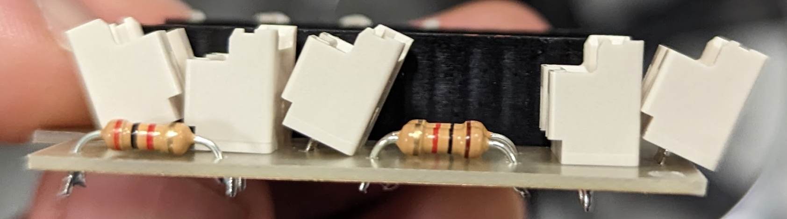
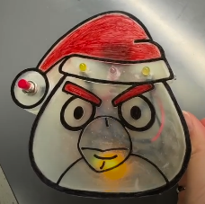
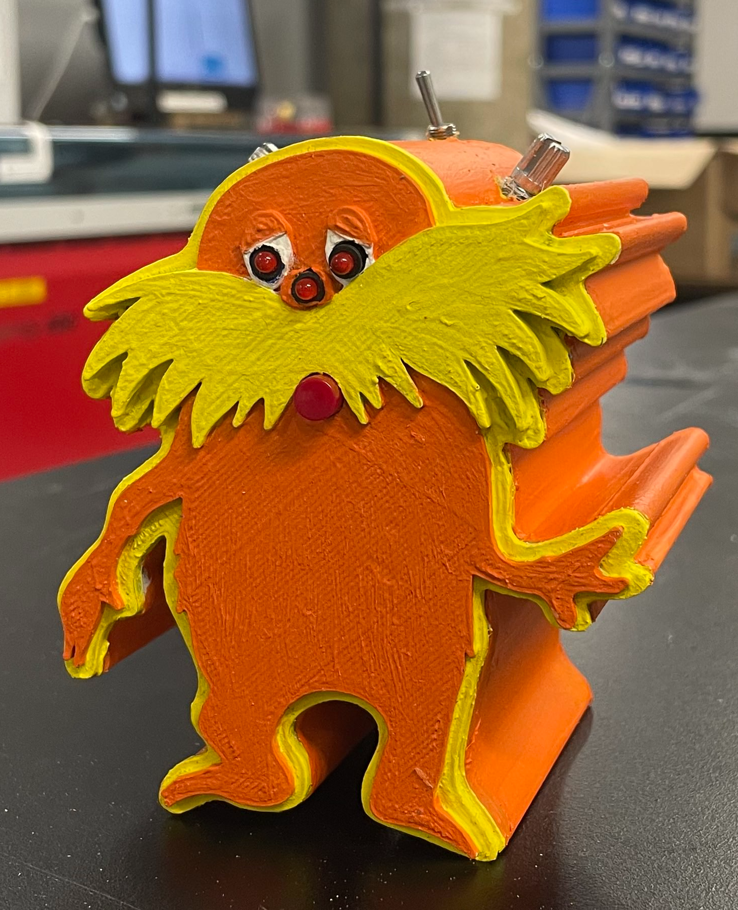
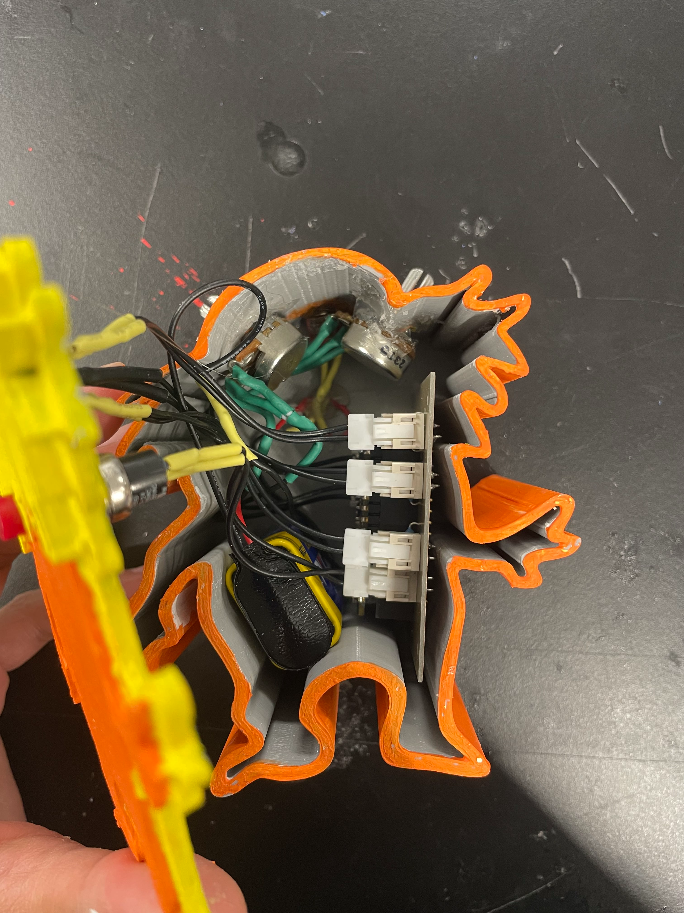

# Lightbox ("One Shot Blinking Light")

Arduino-based firmware developed in the PlatformIO development environment for
the Arduino Nano Every.  

You are expected to use best `git` version control practices for this project,
including meaningful, focused commits with good commit messages.

## Functional Specifications

### Electronics / PCB

* Powered by 9 V battery, connected with a wire harness (i.e., not mounted directly to the PCB).
* SPST toggle power switch (ON/OFF).
* Arduino Nano Every should be mounted to the board using a socket.
* Single-sided traces.
* Battery, switches potentiometers and LEDs should all be panel-mounted and connected to the board individually using 1x2 connectors.
* Each output LED should be driven with a digital output signal input into an `IRFZ44` MOSFET that delivers power to each LED.

#### Commonly Missed Items Checklist

Below is a checklist of things students typically overlook on first pass / should include in their schematics:

* [ ] Make sure that off-board components are `Excluded from board` (in `Properties`).
* [ ] Every connector should have a "mate"; one is on-board, one is off-board.
* [ ] Please include your name in the `GND` pour so we can identify boards during panel milling.
* [ ] Don't forget mounting holes!
* [ ] Don't forget your schematic (and PCB) metadata!
* [ ] Make sure your ERC and DRC pass before submitting for review / milling.

#### Component Footprints

When choosing a footprint for components, such as resistors, make sure to choose
one that will physically allow the component to sit flust on the PCB.  For
example, a low-wattage, ceramic THT resistor, needs ~10 mm of space (pitch)
between its leads to sit flush on a PCB:

:warning: The outline for the 2-pin connectors in KiCad is a bit smaller than the connector bodies that we have.  Give yourself some extra space to prevent the connector bodies from interfering with one another.

Below is a table of the parts you will use in your circuit:

| Description | Part Number | Digikey Part Number |
| --- | --- | --- |
| Arduino Nano Every | ABX00033 | 1050-ABX00033-ND |
| Push Button | PS1024ALRED | EG2025-ND |
| Toggle Switch | SW-T3-1A-A-A3-S1 | 2057-SW-T3-1A-A-A3-S1-ND |
| LED | PM5RD | 492-1659-ND |
| 15 Pin Header | PPTC151LFBN-RC | S7013-ND |
| 9V Battery | ZEUS 9V | 2059-ZEUS9V-ND |
| Battery Connector | 232 | 36-232-ND |
| 2 Pin Connector | B02B-XASK-1 | 455-B02B-XASK-1-ND |
| 2 Pin Jumper | A02XAF02XAF22K152B | 455-3061-ND |
| 10k Potentiometer | PDB181-E420K-103B | PDB181-E420K-103B-ND |
| Transistor | IRFZ44 | (TO220 Packaging) |

### Firmware

The [firmware](src/main.cpp) in this repository is an example of how to approach the function above, but is **not** the solution for the specifications below!!  

* SPST push button switch (ON/OFF) to turn "eye" LEDs on for 5 seconds and "nose" LED for 10 seconds.
* Potentiometer to adjust brightness of "eye" LEDs using [Pulse Width Modulation (PWM)](https://docs.arduino.cc/learn/microcontrollers/analog-output/) (0-100%).
* Potentiometer to adjust blinking rate of "nose" LED (5-10 Hz).
* Have the on-board Nano Every LED (`D13`) act as a "heartbeat" LED blinking at 1 Hz in all states.

### Enclosure

* Make an enclosure of a Blue Devil (or some other fun figure) where two LEDs are the eyes and a third LED is the nose.
* The enclosure will be 3D printed.
* No linear dimension should exceed 15 cm.
* The enclosure should **securely** hold the PCB and battery internally.
* The power switch and push button should be securely panel mounted.
* The potentiometers should be securely panel mounted in the Blue Devil "ears".
* Any solder junctions between wires should be covered with heat shrink tubing.
* Use snap fit or [threaded inserts](https://hackaday.com/2019/02/28/threading-3d-printed-parts-how-to-use-heat-set-inserts/) to attach parts together.
* You do *not* need to include mechanical drawings in your final submission.
* Include a directory in your git repository called `cad/` that includes:
  * A screenshot of your 3D model, saved as `model.png`.
  * The `model.stl` file for your 3D model that was 3D printed.

#### Example "Fun" Enclosures

)
)
)

## Project Management / Implementation Expectations

* Fork this git repository and add Dr. Palmeri as a `Maintainer`.
* Questions about debugging code should be submitted as GitLab Issues that are assigned to your TAs (they can escalated to me).
* Include your KiCad project in a subdirectory called `circuit/`.
* Include your CAD model in a subdirectory called `cad/`, including the files described above.
* Final firmware should use "best" coding practices discussed in lecture, including:
  * Good firmware architecture:
    * `#include`
    * `#define` (MACROS for all pin mappings, specification values, etc.)
    * Function declarations
    * Global variable definitions
    * State machine framework
    * `setup()`
    * `loop()` using state machine framework
    * Function definitions
  * Interrupts for all "events"

## Circuit

* Please include your entire KiCad project in a directory called `circuit/` within your git repository.
* A project template, along with design rules and one project-specific part, are included in `circuit/` for you to use as a starting point.

### Arduino Nano Every Pinout

:warning: Remember that only digital pins annotated with a `~` in the Arduino Nano Every pinout can be used for PWM.

## Testing

Populate the  [testing/technical_report.ipynb](testing/technical_report.ipynb) Jupyter notebook in your repository that includes the following:

* Include a brief outline in your report that describes your testing methodology.
* Include all "raw" data measured during testing in `data*.csv` files.
* Include all statistical analysis and plots associated with your data analysis.
* Include some pictures of your final device, include the fully-assembled version and a picture of the internals, in your report.
* Quantify the linear trend (think linear regression) between your potentiometer setting and the brightness of your "eye" LEDs.
* Quantify the linear trend between your potentiometer setting and the blinking rate of the "nose" LED.
* Quantify the accuracy (think 95% CI) of your heartbeat LED blinking at 1 Hz.
* Discuss any disagreements between your testing results and the expected results from the specifications.

## What to Submit

* Make sure that your git repository containts the firmware, CAD and KiCad components described above.
* Push an annotated tag to your repository called `final_project_submission` that contains the final commit of your project.
* Create an Issue assigned to Dr. Palmeri titled `Final Project Complete`.
* Upload a PDF of your rendered Jupyter notebook to Gradescope and associated each question with the appropriate page in your notebook.
* :warning: **NO LATE SUBMISSIONS ARE ACCEPTED FOR THIS PROJECT.**  Treat the submission of this project just like a final exam timeslot.

## Grading Criteria

* Enclosure (25%)
  * Complexity
  * Internal mounting of PCB and battery
  * Secure panel mounting of switches and potentiometers
  * Fit of pieces
  * Meets size constraints
  * git repository organization
* Circuit (25%)
  * Correctness of circuit
  * Correctness of PCB layout
  * Soldering / wire routing / heat shrink tubing
  * Mounting
  * git repository organization
* Firmware (25%)
  * State maching implementation
  * Use of macros, variables, strcuts, etc.
  * Interrupts
  * Modularity of code (e.g., functions)
  * Readability of code
  * git repository organization
* Testing (25%)
  * Technical report
  * Data analysis
  * Live demo
  * git repository organization

### Letter Grade Equivalents

* A[+/-]: Industry internship worthy
* B[+/-]: Good, but needs some work
* C[+/-]: Passable, but needs significant work
* D: Major flaws

## Resources

* [PlatformIO: Nano Every](https://docs.platformio.org/en/stable/boards/atmelmegaavr/nano_every.html)
* [Arduino Nano Every Datasheet](https://docs.arduino.cc/resources/datasheets/ABX00028-datasheet.pdf)
* [Hackaday: Heat Set Inserts](https://hackaday.com/2019/02/28/threading-3d-printed-parts-how-to-use-heat-set-inserts/)
* [Arduino: Analog (PWM) Output](https://docs.arduino.cc/learn/microcontrollers/analog-output/)
