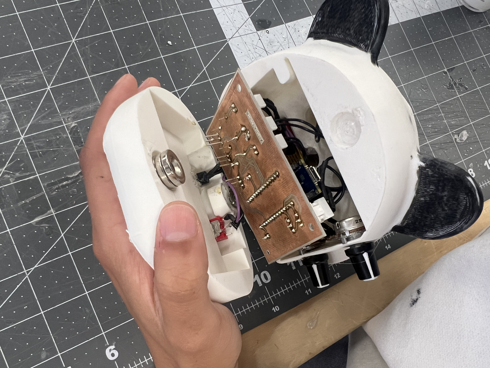
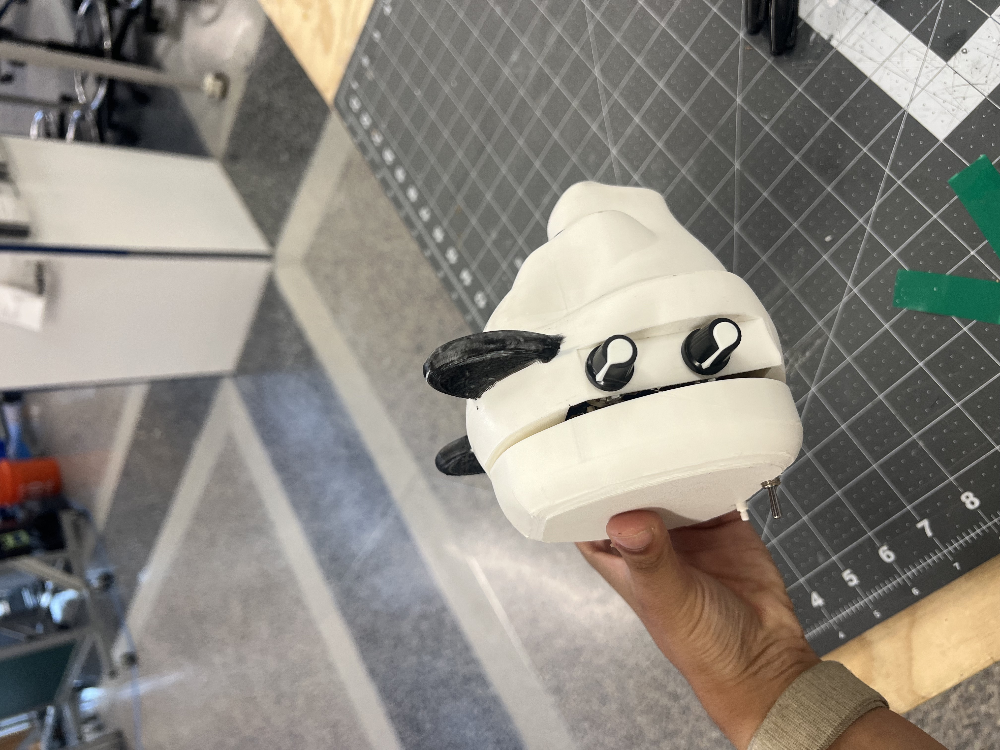
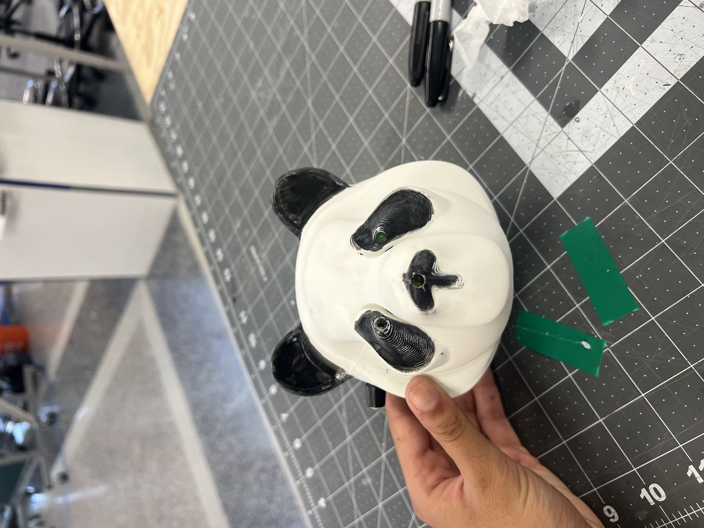
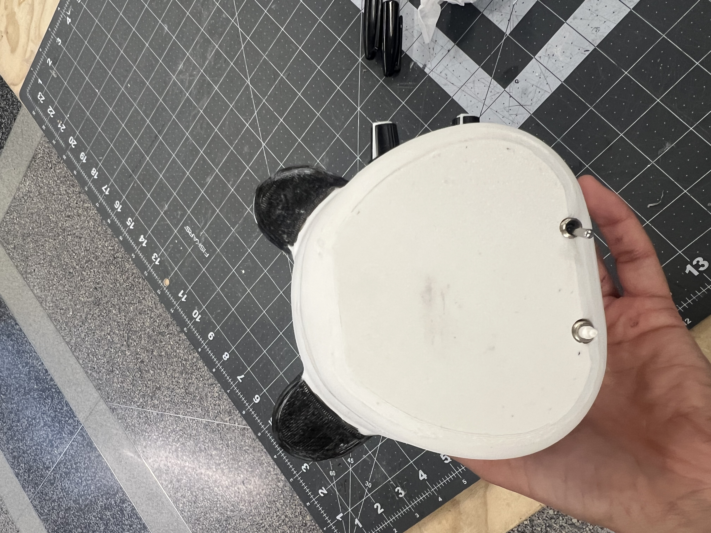
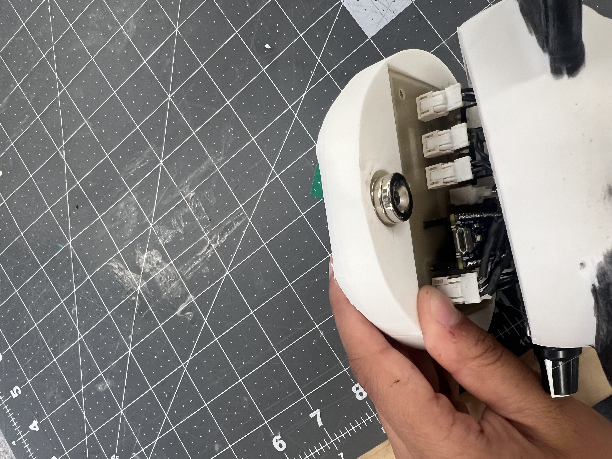

# Lightbox

A custom embedded systems project built for BME 254 at Duke University — a 3D-printed panda enclosure housing a hand-soldered PCB, Arduino Nano Every, and three independently controlled LEDs (two eyes and a nose).

---

## Overview

When a button is pressed, the panda's eyes light up for 5 seconds and its nose blinks for 10 seconds. The brightness of the eyes and blink rate of the nose are each controlled by a dedicated potentiometer mounted in the ears. An onboard heartbeat LED blinks at 1 Hz in all states to confirm the device is running.

---

## Hardware

| Component | Detail |
|---|---|
| Microcontroller | Arduino Nano Every (ATmega4809) |
| PCB | Custom single-sided board, hand-milled and soldered |
| LED drivers | IRFZ44 N-channel MOSFETs |
| Enclosure | 3D-printed PLA, two-part snap fit |
| Power | 9 V battery with SPST toggle switch |
| Controls | SPST push button + 2× 10 kΩ potentiometers |




---

## Firmware

Written in C++ using the Arduino framework via PlatformIO. Key design decisions:

- **State machine** with three explicit states: `IDLE`, `ANALOG_READ`, and `LED_OUTPUT`
- **Interrupt-driven** button input using `attachInterrupt()` — no polling in the main loop
- **Non-blocking timing** throughout using `millis()` — no `delay()` calls anywhere
- **PWM brightness control** on the eye LEDs via `analogWrite()`, mapped linearly from the potentiometer ADC reading
- **Clean digital blink** on the nose LED using `digitalWrite()` to avoid the Nano Every's 255/256 PWM artifact
- All pin assignments and timing constants defined as `#define` macros at the top of the file

```
IDLE ──(button press)──▶ ANALOG_READ ──▶ LED_OUTPUT ──(10 s elapsed)──▶ IDLE
```

---

## Testing Results

All measurements taken with a Tektronix TBS 1102B oscilloscope.

**Heartbeat LED**
- Period: 1000 ms, Frequency: 1.000 Hz, Duty cycle: 50.0%
- Identical in both IDLE and LED_OUTPUT states
- Zero measurable variation across 10 trials in each state (limited by oscilloscope resolution)

**Eye LED brightness (vs. potentiometer resistance)**
- Linear relationship (R² ≈ 1.0) from 0% duty cycle at max resistance to ~80% at minimum
- Did not reach 100% due to potentiometer mechanical travel limits

**Nose LED blink rate (vs. potentiometer resistance)**
- Linear relationship from 5.00 Hz (max resistance) to 7.45 Hz (min resistance)
- Lower bound matches spec exactly; upper bound limited by the same pot range constraint

---

## Gallery

| Assembled | Back panel |
|---|---|
|  |  |

| Internals (PCB) | Internals (Arduino + connectors) |
|---|---|
|  |  |

---

## Built With

- **PlatformIO** — build system and upload toolchain
- **KiCad** — schematic capture and PCB layout
- **Fusion 360 / CAD** — enclosure design
- **Python / Jupyter** — data analysis and technical report (scipy, matplotlib, pandas)
