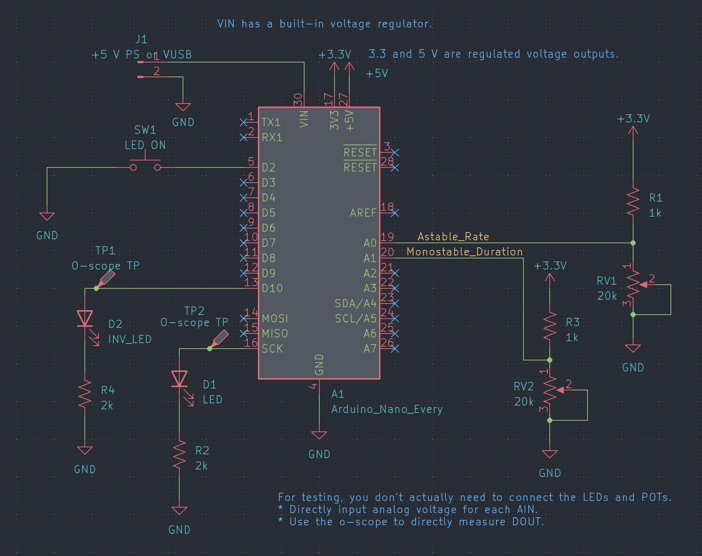
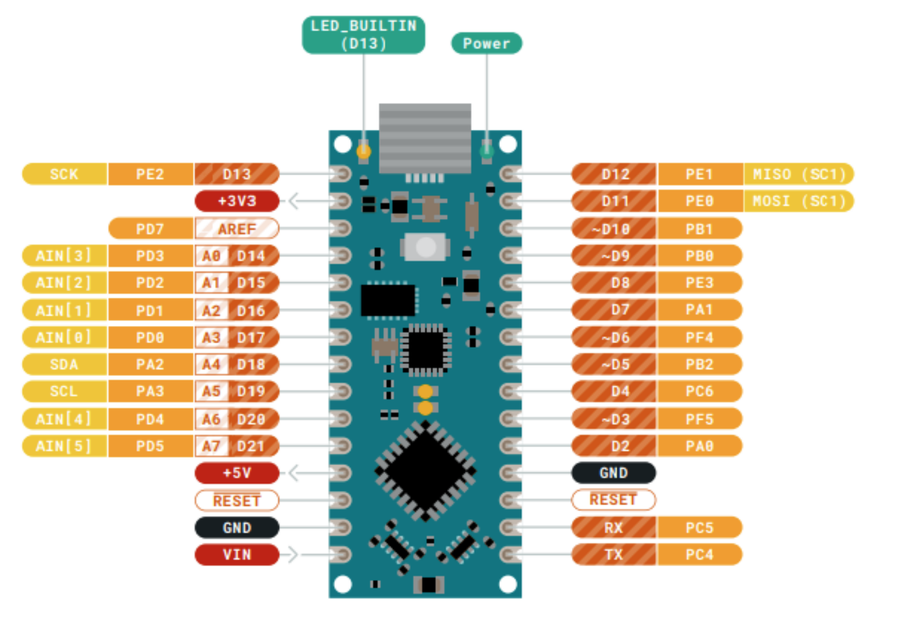
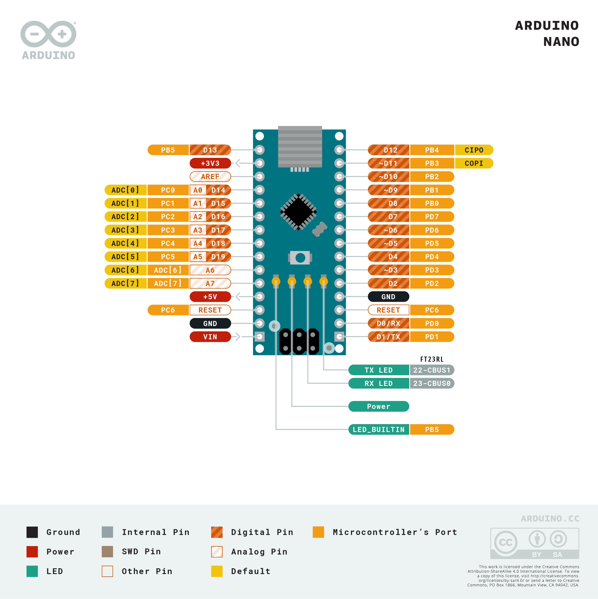

# One Shot Blinking Light Firmware

Arduino-based firmware developed in the PlatformIO development environment for
the Arduino Nano Every.  The fireware in this repository is an example of how to
approach the function above, but is **not** the solution for the specifications
above!!  

## Functional Specifications
### Firmware
* Powered by 9 V battery.
* SPST toggle power switch (ON/OFF).
* SPST push button switch (ON/OFF) to turn LEDs (`D1-2`) on for 5 seconds and LED
  (`D3`) for 10 seconds.
* Potentiometer to adjust brightness of LED `D1-2` using PWM (0-100%).
* Potentiometer to adjust blinking rate of LED `D3` (5-10 Hz).

### PCB
* Arduino Nano should be mounted to the board using a socket.
* Single-sided traces.
* Battery, switches potentiometers and LEDs should all be panel-mounted and
  connected to the board individually using 1x2 sockets.

### Enclosure
* Make an enclosure of a Blue Devil (or some other fun figure) where `D1-2` are
  the eyes and `D3` is the nose.
* The enclosure should be designed to be 3D printed.
* The enclosure should securely hold the PCB and battery internally.
* The power switch and push button should be securely panel mounted.
* The potentiometers should be securely panel mounted in the Blue Devil "ears".
 
## Circuit
KiCad project is under `circuit/`.



### Arduino Nano Every Pinout


### Arduino Nano Pinout


## Troubleshooting
```
avrdude: ser_open(): can't open device "/dev/ttyACM0": Permission denied
```

Make sure that you set permissions to allow your device connected via USB to be
accessed via VS Code:
https://support.arduino.cc/hc/en-us/articles/360016495679-Fix-port-access-on-Linux

## Resources
* https://docs.arduino.cc/resources/datasheets/ABX00028-datasheet.pdf
* https://docs.arduino.cc/resources/datasheets/ABX00031-datasheet.pdf
* https://docs.platformio.org/en/stable/boards/atmelmegaavr/nano_every.html
* https://docs.platformio.org/en/latest/boards/nordicnrf52/nano33ble.html

Copyright (c) [2023] [Mark L. Palmeri]
